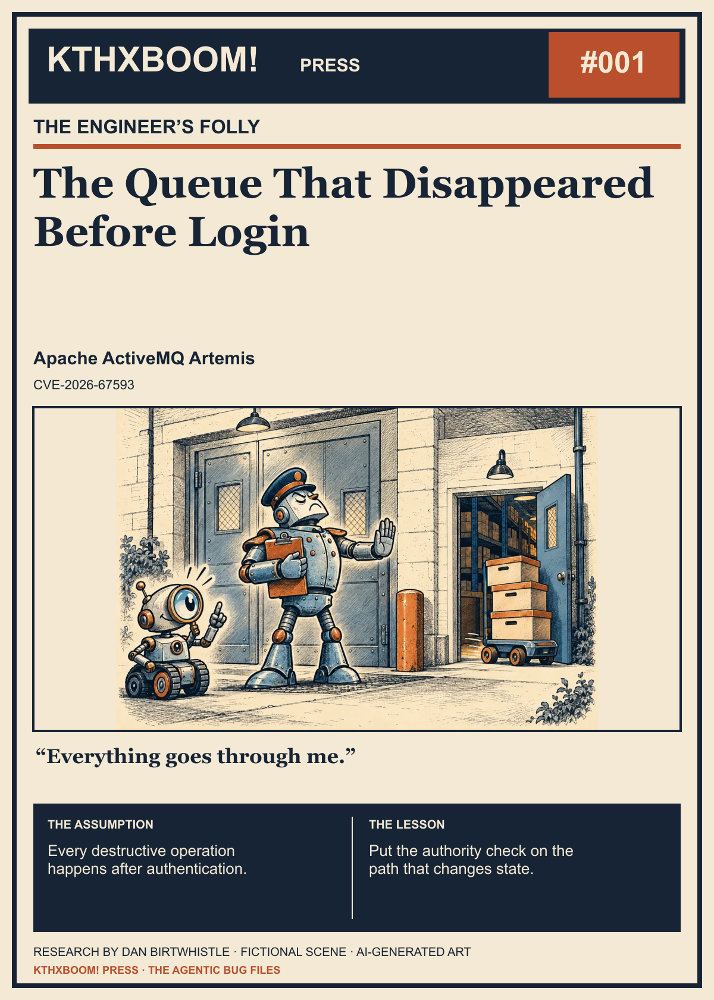

# The Queue That Disappeared Before Login

> Public review edition — feedback and editorial revisions welcome.

**KTHXBOOM! Press · The Engineer’s Folly · Issue #001**  
Research and editorial: [Dan Birtwhistle (@dabirt)](https://github.com/dabirt)

The front door checked credentials. The side door had other ideas.

## The illustrated story

### Panel 1: The official entrance

> Everything goes through me.

Assumption guards the front door. Scout notices that the floor plan contains another route.

### Panel 2: Meanwhile, at the side door…

> Does the cart know about the checklist?

The queue leaves through an unchecked entrance. This warehouse joke illustrates an authorization boundary, not a literal discovery scene.

### Panel 3: Put the check on the operation

> Now the cart needs permission too.

Scout and Assumption move the authority check to the path that changes state. The lesson is about enforced ordering.

*Original AI-generated artwork; dialogue and scenes are fictional metaphors, not discovery transcripts or exact technical reconstructions.*

## The research file

**Project:** Apache ActiveMQ Artemis  
**Identifiers:** CVE-2026-67593  
**Severity, as sourced:** Important · Apache  
**Remediation reference:** Apache Artemis 2.57.0  
**Sources last reviewed:** 2026-10-30

## What this software does

[Apache Artemis](https://artemis.apache.org/) is a message broker: it holds and routes messages so applications can exchange work without having to run in lockstep. It supports messaging protocols and clients across Java, JavaScript, C/C++, Python, and .NET. That makes it infrastructure between applications, rather than just a desktop tool. Its multi-language ecosystem explains the relevance of a queue-deletion finding; it does not tell us how many installations expose the affected OpenWire path.

## The assumption

The guard has a clipboard, a uniform, and absolute confidence in the floor plan. All three look reassuring. None of them closes the side entrance.

Our fictional scene makes one architectural question visible: does the operation actually pass through the control that is supposed to authorize it?

## What the public record establishes

Apache identifies an OpenWire command path that can delete a durable-subscription queue before connection authentication and authorization, or later. The advisory rates the issue **Important**, recommends **Apache Artemis 2.57.0**, and credits **Dan Birtwhistle** as finder. **krsecurity(kongr)** and **Dilrevx, NSSL, SJTU** are credited as reporters.

The affected package ranges differ:

| Package | Affected releases |
| --- | --- |
| Apache Artemis OpenWire and Jakarta OpenWire | 2.50.0–2.56.0 |
| Apache ActiveMQ Artemis OpenWire | 1.0.0–2.44.0 |
| Apache ActiveMQ Artemis Jakarta OpenWire | 2.32.0–2.44.0 |

This is a queue-deletion advisory. It does not establish remote code execution or compromise of every deployment. Consult the vendor record for the package you actually use.

## Research notebook: One operation, two permission paths

On a loopback-only Artemis 2.56.0-SNAPSHOT instance, a restricted authenticated user was denied deletion permission. A separate anonymous OpenWire path removed a named durable subscription and its persistent marker. The recorded prerequisites were a reachable OpenWire acceptor and a known or derivable subscription name. A local reference correction preserved both subscription and marker.

The useful contrast is the disagreement between two authority paths. It does not demonstrate arbitrary-queue deletion, message disclosure, or code execution. The reference correction was a researcher control, not a replay of Apache’s final 2.57.0 release.

*Evidence: original research records supplied for editorial review. These observations have not been independently rerun for this publication. Public upstream fixes and tests are linked separately below.*

## The assumption that broke

**Editorial interpretation:** the intended order of a connection lifecycle is not proof of the order enforced by each command handler. A system can have authentication and still expose a meaningful operation before authentication has completed.

The architectural drawing says “everything enters here.” The review has to ask whether the code agrees.

## A question to carry into your next review

Pick one operation that changes persistent state. Trace every way to reach it. Identify exactly where identity becomes known, where permission is checked, and whether failure stops the state change. Repeat for unusual commands and partially initialized connections.

That exercise is useful even in systems with an excellent central authentication component. It turns a general assurance into a claim about a particular path.

## What this story is—and isn’t

The warehouse is a metaphor, and the dialogue is invented. This article summarizes public advisory facts and adds an engineering interpretation. It does not reconstruct the discovery process or claim an independent patch audit. Credit for remediation belongs to the maintainers.

## Fixes, mitigations, and reproduction references

Follow [Apache’s advisory](https://artemis.apache.org/components/artemis/security) for the exact package and affected range; its remediation reference is Artemis **2.57.0**. No additional vendor-supported workaround was established in the reviewed material.

The public announcement describes the affected command path. A descriptive advisory is different from a downloadable, independently checked reproducer. No new PoC was executed during this publication build. Any original demonstration will be reviewed separately, using an owned local fixture and the documented scope of the durable-subscription operation.

## What the public patch adds

The public fix has two layers: [authentication and authorized deletion](https://github.com/apache/artemis/commit/5b541819a274f1fff1e3db8aa1bea2598d1a018b), followed by [connection/client-ID binding](https://github.com/apache/artemis/commit/6fcc19573c73b7c064cdf1a7c1329ea606d5b9de). The second change matters: a completed login does not by itself establish ownership of the subscription named in a command. The linked commits include upstream regression tests; their source was reviewed, but those tests were not executed for this publication.

## Primary sources and credit

- [Apache security index](https://artemis.apache.org/components/artemis/security) — advisory
- [Apache advisory announcement](https://www.openwall.com/lists/oss-security/2026/09/10/6) — advisory
- [CVE record](https://www.cve.org/CVERecord?id=CVE-2026-67593) — record
- [Apache Artemis project overview](https://artemis.apache.org/) — background

Maintainers own the remediation work. See the evidence above for finder, reporter, and co-discovery distinctions. No vendor endorsement implied.

[Download the illustrated issue](issue.pdf)
