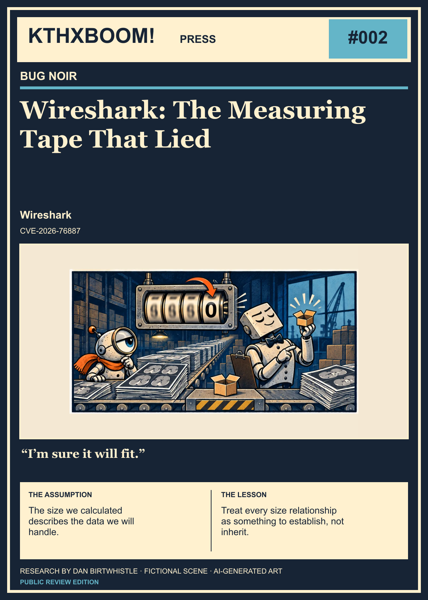

# Wireshark: The Measuring Tape That Lied

**KTHXBOOM! Press · Bug Noir · Issue #002**  
Research and editorial: [Dan Birtwhistle (@dabirt)](https://github.com/dabirt)

The counter wrapped. The shipment didn’t. The packing station paid for the disagreement.

## The illustrated story

**Data in this story:** DICOM PDV data / shared reassembly

### Panel 1: The counter wraps. The shipment does not.

> According to the total, this should fit.

The counter rolls over. Assumption picks a tiny box for many synthetic scan sheets: the DICOM PDV-data route to shared Wireshark reassembly.

### Panel 2: Overflow at the packing station

> Did anyone tell the shipment?

The sheets keep arriving. They burst past the undersized box and buckle the packing station: a metaphor for copying beyond allocated memory.

### Panel 3: The analyzer crashes

> The counter wrapped. The shipment didn’t.

REASSEMBLY HALTED. The packing station collapses: Wireshark can crash. The scans represent DICOM traffic; no medical-device failure is established.

*Original AI-generated artwork; dialogue and scenes are fictional metaphors, not discovery transcripts or exact technical reconstructions.*

## The research file

**Project:** Wireshark  
**Identifiers:** CVE-2026-76887  
**Severity, as sourced:** No severity stated · vendor advisory  
**Remediation reference:** Wireshark 4.6.8 / 4.4.18  
**Sources last reviewed:** 2026-10-31

## What this software does

[Wireshark](https://www.wireshark.org/about) is an open-source network protocol analyzer. Network engineers, security researchers, and educators use it to inspect live traffic and saved captures; TShark provides command-line analysis. The project describes it as an established standard across industries and education, with support for hundreds of protocols. A packet capture may be evidence for an investigation, but to the analyzer it is also input that must be parsed.

## Where DICOM enters the story

[DICOM—Digital Imaging and Communications in Medicine](https://dicom.nema.org/medical/dicom/2025a/output/html/part01.html)—defines communication and management of medical imaging information and related data. Wireshark can dissect that network traffic. In the [public research report](https://gitlab.com/wireshark/wireshark/-/work_items/21423), DICOM presentation-data-value (PDV) reassembly was one of three demonstrated routes to the same shared reassembly defect.

The distinction matters: this finding concerns **Wireshark analyzing DICOM traffic**. It is not evidence of a vulnerability in an imaging device or PACS server merely because that system uses DICOM.

## What can fail

Wireshark or TShark can crash while inspecting a sufficiently large crafted stream. The underlying failure is a heap-buffer overflow: a wrapped total produces an undersized allocation, then the full fragments are copied beyond it. This interrupts analysis; code execution is not established. The demonstrated route requires more than 4 GiB of actual captured fragment data in one reassembly sequence and enough memory to retain it.

## The assumption

The counter rolls over. A huge quantity of normal-sized scan sheets keeps arriving, although Assumption has selected a tiny box. The sheets burst past the box, buckle the packing table, and leave the station collapsed: **the analyzer has crashed**.

The scan sheets depict the **DICOM route only**. SMTP supplied mail data, and WebSocket supplied fragmented message data; the medical imagery is not a claim about those other payloads.

The counter represents the stored total, the box represents the allocation, and the overflowing shipment represents the subsequent copies. The stopped packing station represents Wireshark, not a scanner or PACS. The scan sheets are a visual joke about actual data volume, not a claim that pixel dimensions alone trigger the flaw.

## What the public record establishes

Wireshark’s [advisory](https://www.wireshark.org/security/wnpa-sec-2026-69) identifies **CVE-2026-76887**, a dissection-engine crash during packet reassembly, and credits **Dan Birtwhistle** with discovery. It lists affected releases **4.6.0–4.6.7** and **4.4.0–4.4.17**, with fixes in **4.6.8** and **4.4.18**.

The detailed public report explains the shared root: the block-sequence reassembly engine accumulated fragment lengths in a **32-bit total**. When the genuine data total exceeded that representation, it could wrap to a smaller value. Allocation used the smaller total, while subsequent copies still used the full fragment lengths. The result was an undersized allocation followed by a heap overwrite in the instrumented tests.

This is a shared reassembly issue with multiple demonstrated drivers, rather than three unrelated protocol bugs.

## Research notebook: The bytes had to be real

The report documents these routes:

| Path | What the public report records |
| --- | --- |
| DICOM PDV reassembly | A deterministic **4.3 GiB** capture reached the shared root. |
| SMTP DATA reassembly | A deterministic capture reached the wrap; the focused sanitizer evidence records the subsequent overwrite. |
| WebSocket message reassembly | A normal HTTP Upgrade followed by one fragmented binary message reached the same root. |

The hard prerequisite was **more than 4 GiB of genuinely captured fragment data in one reassembled sequence**, plus enough memory to retain it. Merely declaring a huge length without supplying the captured bytes did not reach the copy. DICOM and SMTP used their normal reassembly settings; the report describes WebSocket message reassembly as unconditional.

The SMTP and WebSocket AddressSanitizer runs each recorded a **65,480-byte write beyond a 20,000-byte allocation**. Those exact overwrite measurements belong to those two runs; they are not being attributed to the DICOM run. The runtime campaign used the recorded master-source revision. The stable release tags were inspected for the same boundary, but the multi-gigabyte sanitizer run was not repeated on those tags.

The report inventories 54 consumers of related APIs, but demonstrates only these three paths. It does not claim a cheap trigger, successful exploitation on an unsanitized build, or code execution. The published observations have not been independently rerun for this article, and no final fixed-release replay is claimed.

## The assumption that broke

**Editorial interpretation:** a length is a claim with a representation, not an unlimited mathematical integer. Adding valid fragment lengths can still produce a total that the chosen type cannot represent.

The check has to protect the relationship between **bytes received, total represented, storage allocated, and bytes copied**. A trustworthy fragment length does not make its running total trustworthy automatically.

The important twist is the input cost. This was not a tiny packet carrying a theatrical number. The bytes had to exist. That makes the result expensive to reach; it does not make allocating the wrapped total correct.

## What changed in the fix

The public correction bounds reassembly lengths before an unrepresentable total becomes an allocation or copy decision. The patch trail includes the [primary correction](https://gitlab.com/wireshark/wireshark/-/commit/9f68da57d360629eb7cee8d97d2f894b4858ce8f), [4.6 backport](https://gitlab.com/wireshark/wireshark/-/commit/1df97a20fbd181ad8258db5ce60609b8ccdbf079), and [4.4 backport](https://gitlab.com/wireshark/wireshark/-/commit/c1378c3314761a7a24fd19fe68eaac63046cac1f). Their identities and branch references were checked through the public repository API. Reviewing a patch is separate from running a fixed-build control.

Use a supported Wireshark release containing the fix. **4.6.8 and 4.4.18 were the fixing releases**, not a recommendation to downgrade a newer installation. Consult the vendor advisory for the affected branch. No vendor-supported workaround beyond updating was established in the reviewed material.

## Evidence and reproduction references

The [public report](https://gitlab.com/wireshark/wireshark/-/work_items/21423) links SMTP and WebSocket capture generators, focused sanitizer transcripts, and hashes. It states that the DICOM generator and focused transcript were available on request. These are references to the published evidence, not newly executed tests or a claim that every artifact was independently downloaded and checked here. No patient data is needed to explain the synthetic-capture result.

This edition does not mirror the generators or distribute a multi-gigabyte capture. The useful regression question can be smaller: does the reassembly engine reject an unrepresentable aggregate length before allocation and copying? The report proposes synthetic fragment metadata or a test-only small ceiling for that decision.

## A question to carry into your next review

Pick a parser that combines many individually valid pieces. Which type stores the total? What proves that the total fits? Does the same checked value govern allocation, copying, and bookkeeping?

The measuring tape is fictional. The engineering lesson is concrete: **the box must be sized for the bytes that will actually arrive.**

## Primary sources and credit

- [Wireshark advisory 2026-69](https://www.wireshark.org/security/wnpa-sec-2026-69) — advisory
- [Wireshark primary reassembly correction](https://gitlab.com/wireshark/wireshark/-/commit/9f68da57d360629eb7cee8d97d2f894b4858ce8f) — patch
- [Wireshark 4.6 backport](https://gitlab.com/wireshark/wireshark/-/commit/1df97a20fbd181ad8258db5ce60609b8ccdbf079) — patch
- [Wireshark 4.4 backport](https://gitlab.com/wireshark/wireshark/-/commit/c1378c3314761a7a24fd19fe68eaac63046cac1f) — patch
- [Wireshark purpose, features, and industry use](https://www.wireshark.org/about) — background
- [Public research report: three reassembly paths and evidence](https://gitlab.com/wireshark/wireshark/-/work_items/21423) — record
- [DICOM standard: scope and medical imaging information](https://dicom.nema.org/medical/dicom/2025a/output/html/part01.html) — background

Maintainers own the remediation work. See the evidence above for finder, reporter, and co-discovery distinctions. No vendor endorsement implied.

## Read and share

[Illustrated PDF](issue.pdf) · [Comic 1 — the assumption](social-comic-1.png) · [Comic 2 — the crash](social-comic-2.png)
