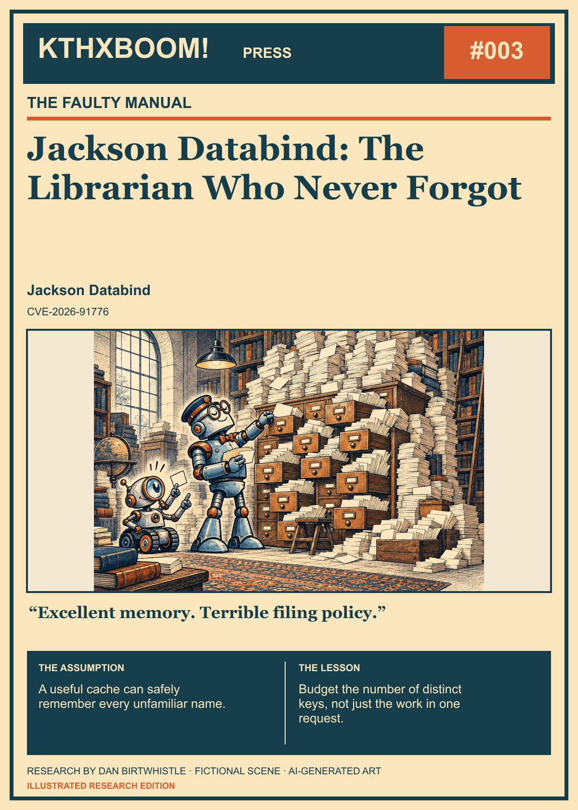

# Jackson Databind: The Librarian Who Never Forgot

**KTHXBOOM! Press · The Faulty Manual · Issue #003**  
Research and editorial: [Dan Birtwhistle (@dabirt)](https://github.com/dabirt)

The answer was always the same. The filing cabinet kept growing anyway.

## The illustrated story

**Data in this story:** JSON type IDs / fallback-deserializer cache

![Three-panel fictional comic. Panel 1: Each card represents an unfamiliar JSON type ID. Every new name gets a retained card, although all resolve to the same fallback implementation. Panel 2: Retained cards crowd out useful work: persistent cache growth can exhaust memory and deny service. The timing depends on configuration and workload. Panel 3: A finite tray and return chute illustrate bounded retention. The actual patch clears at a threshold and avoids some insertions; it does not stop caching altogether.](comic-1200.webp)

### Panel 1: One answer, many introductions

> New name? New card. Same answer.

Each card represents an unfamiliar JSON type ID. Every new name gets a retained card, although all resolve to the same fallback implementation.

### Panel 2: The filing cabinet keeps the bill

> We’re going to need a bigger library.

Retained cards crowd out useful work: persistent cache growth can exhaust memory and deny service. The timing depends on configuration and workload.

### Panel 3: A memory needs a policy

> Let’s give that memory a forgetting policy.

A finite tray and return chute illustrate bounded retention. The actual patch clears at a threshold and avoids some insertions; it does not stop caching altogether.

*Original AI-generated artwork; dialogue and scenes are fictional metaphors, not discovery transcripts or exact technical reconstructions.*

## The research file

**Project:** Jackson Databind  
**Identifiers:** CVE-2026-91776  
**Severity, as sourced:** High · project advisory  
**Remediation reference:** 2.18.11 / 2.21.7 / 2.22.3 / 3.1.7 / 3.2.3  
**Sources last reviewed:** 2026-11-10

## What this software does

[Jackson](https://github.com/FasterXML/jackson) is a Java/JVM data-processing toolkit; Jackson Databind translates JSON into application objects and back. It often sits behind API endpoints rather than appearing as a product users launch. Its ecosystem role is concrete: [Spring documents Jackson-backed JSON message converters](https://docs.spring.io/spring-framework/reference/web/webmvc/message-converters.html) for HTTP clients and REST controllers. That integration shows why the library matters, without implying that every Spring or Jackson application enables the specific configuration required by this finding.

## What can fail

The affected application can lose availability as attacker-influenced names accumulate in a persistent cache and consume memory. The prerequisite is the fallback configuration and a long-lived mapper described below. The library fills the filing room; this does not establish an immediate crash from one request or a universal time to exhaustion.

## The assumption

The librarian has an admirable memory and no discard policy. Every new name receives a fresh card, even when every visitor is directed to the same room. It is a wonderful service until the cards occupy the building.

## What the public record establishes

The FasterXML advisory concerns **name-based polymorphic deserialization with a fallback implementation**, attacker-influenced type IDs, and a long-lived mapper. Distinct unknown names resolve to the same fallback but remain separate keys in a persistent deserializer cache. This can create memory pressure and denial of service across requests.

The project rates the advisory **High**, credits **dabirt** as reporter, and lists fixes in **2.18.11, 2.21.7, 2.22.3, 3.1.7, and 3.2.3**. Its affected-version metadata spans several 2.x and 3.x branches; its narrative cautions that the earliest affected floor was not established. Check the advisory’s exact package and branch, rather than inferring that every Jackson application is exposed.

The report does not claim code execution, a one-request allocation spike, a fixed memory cost per name, or a universal time to exhaustion.

## Research notebook: Same request count. Different filing bill.

On Jackson 2.22.1 and 3.2.1, 10,000 distinct unknown type IDs produced 10,000 retained cache entries; 10,000 repetitions of one unknown ID produced one. The recorded setup used JDK 21, a 512 MiB JVM, name-based polymorphic deserialization with a fallback implementation, and a long-lived mapper.

The comparison isolates input novelty from request count. It measures retained entries, not bytes per key or time to exhaustion. The record does not include a replay of the final fixed releases. The public patch and these vulnerable-release observations answer different questions.

*Evidence: original research records supplied for editorial review. These observations have not been independently rerun for this publication. Public upstream fixes and tests are linked separately below.*

## The assumption that broke

**Editorial interpretation:** the number of requests and the number of distinct keys are different budgets. A workload may be cheap per request while still leaving an accumulating cost after every request is over.

A fallback is often introduced to make unfamiliar input manageable. That intention does not automatically bound the metadata created while selecting the fallback. The engineering question lives in the bookkeeping as much as in the deserializer.

## A question to carry into your next review

For every long-lived cache influenced by external input, ask three things: what introduces a new key, what releases it, and what happens when the key space is much larger than the useful answer space?

A meaningful control compares repeated use of one unknown name with many different unknown names. Those workloads can have the same request count and radically different retention behavior.

## What stays with the reader

The lesson is not “caches are dangerous.” It is that a cache is a policy for keeping things, and every keeping policy needs a limit or a reason that its input space is already bounded. Our librarian could use a little less enthusiasm and a clearly specified filing rule.

## Fixes, mitigations, and reproduction references

Use the [project advisory](https://github.com/FasterXML/jackson-databind/security/advisories/GHSA-wv8q-qhhj-9h54) to select the correct package and branch: **2.18.11, 2.21.7, 2.22.3, 3.1.7, or 3.2.3**. No vendor-supported workaround beyond updating was established in the reviewed material.

The fallback, attacker-influenced names, and mapper lifetime are exposure conditions, not a universal Jackson configuration. The advisory’s example is public; this publication build has not executed it. If we release an original control harness, it should distinguish repeated names from distinct names with a bounded workload and document exactly which version it tested.

## What the public patch adds

The [final public cache fix](https://github.com/FasterXML/jackson-databind/commit/2870d1d6dc1b7e1c07ee11dd5b04ab71cddbb577) preserves fallback caching for performance. It clears the cache at a 1,000-entry threshold, skips insertion for IDs longer than 256 characters, and avoids selected reader-dependent fallback entries. These policies bound retention differently; they are not a hard process-memory guarantee. The commit includes regression tests for growth, key-length boundaries, and fallback configuration. Source review is distinct from independently running those tests.

## Primary sources and credit

- [FasterXML project advisory](https://github.com/FasterXML/jackson-databind/security/advisories/GHSA-wv8q-qhhj-9h54) — advisory
- [Jackson 2.18.11 release notes](https://github.com/FasterXML/jackson/wiki/Jackson-Release-2.18.11) — release
- [Jackson project overview](https://github.com/FasterXML/jackson) — background
- [Spring HTTP message conversion and Jackson integration](https://docs.spring.io/spring-framework/reference/web/webmvc/message-converters.html) — background

Maintainers own the remediation work. See the evidence above for finder, reporter, and co-discovery distinctions. No vendor endorsement implied.

## Read and share

[Illustrated PDF](issue.pdf) · [Comic 1 — the assumption](social-comic-1.png) · [Comic 2 — the overload](social-comic-2.png) · [Comic 3 — the correction](social-comic-3.png)
