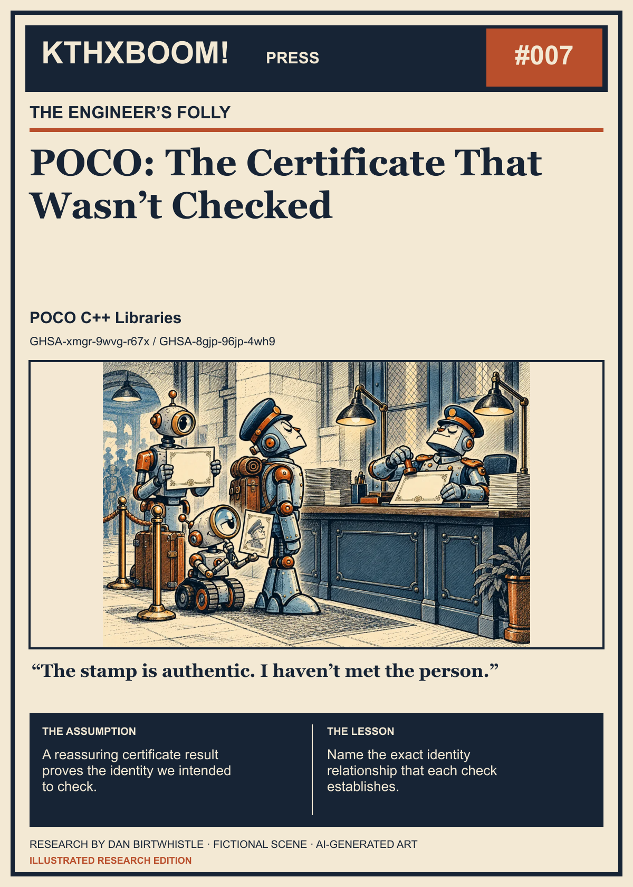

# POCO: The Certificate That Wasn’t Checked

**KTHXBOOM! Press · The Engineer’s Folly · Issue #007**  
Research and editorial: [Dan Birtwhistle (@dabirt)](https://github.com/dabirt)

The paperwork was immaculate. The identity check was more of a vibe.

## The illustrated story

**Data in this story:** TLS certificates / hostnames / OCSP responses

![Three-panel fictional comic. Panel 1: The paperwork represents TLS certificates and OCSP responses. An authentic-looking document does not establish every required identity relationship. Panel 2: Two separate failures: trusting the wrong host, or accepting a false status for a revoked certificate under extra conditions. The next application action determines the harm. Panel 3: Check the intended host and the authority behind certificate status separately. These are distinct controls with distinct prerequisites; a green result must answer the right question.](comic-1200.webp)

### Panel 1: The paper looks impressive

> The stamp is authentic. Next!

The paperwork represents TLS certificates and OCSP responses. An authentic-looking document does not establish every required identity relationship.

### Panel 2: The wrong relationship passes inspection

> We have answered a different question.

Two separate failures: trusting the wrong host, or accepting a false status for a revoked certificate under extra conditions. The next application action determines the harm.

### Panel 3: Name the proposition

> This check establishes that…

Check the intended host and the authority behind certificate status separately. These are distinct controls with distinct prerequisites; a green result must answer the right question.

*Original AI-generated artwork; dialogue and scenes are fictional metaphors, not discovery transcripts or exact technical reconstructions.*

## The research file

**Project:** POCO C++ Libraries  
**Identifiers:** GHSA-xmgr-9wvg-r67x · GHSA-8gjp-96jp-4wh9  
**Severity, as sourced:** High / Moderate · separate project advisories  
**Remediation reference:** POCO 1.15.4  
**Sources last reviewed:** 2026-11-17

## What this software does

[POCO](https://docs.pocoproject.org/current/00100-GuidedTour.html) is a collection of portable C++ libraries for networked applications, including networking, TLS, data formats, and storage-related functions. Its components can be embedded inside larger software rather than installed as a visible standalone app. The project’s [about page](https://pocoproject.org/about.html) reports use by thousands of open-source and commercial projects. That project-reported adoption claim, checked October 30, 2026, describes ecosystem reach—not how many products use an affected component or configuration.

## What can fail

In simple terms, an affected application can be fooled about **who it is connected to**, or, under different conditions, whether a certificate has been **revoked**. That can matter if the application then sends secrets or trusts the server’s answers. Encryption can still work while the application trusts the wrong endpoint. These are two separate trust failures with different prerequisites; the practical examples below are conditional impact analysis, not a claim that a production product was compromised.

## The assumption

The inspector approves the paper. The scout wonders whether anyone has approved the person holding it. Both have looked at a certificate; they have asked different questions.

## What the public record establishes

These are **two separate POCO advisories**, each crediting **dabirt** as reporter and fixed in **1.15.4**.

**GHSA-xmgr-9wvg-r67x — High:** configuration-driven SSLManager client contexts defaulted hostname verification off. The affected range is **1.5.0–1.15.3**. The correction enables that client-side default. This does not describe every programmatic Context or every TLS application using POCO.

**GHSA-8gjp-96jp-4wh9 — Moderate:** an explicitly enabled OCSP-stapling verification path could accept a response using a substituted issuer. The range is **1.11.0–1.15.3**. A practical revocation bypass also needs endpoint/path control and a legitimately chaining revoked leaf certificate’s private key. This is not a general certificate-validation bypass.

The OCSP maintainer notes say the correction was code-reviewed without a permanent regression test in that suite. This site does not claim to have independently closed that test gap.

## Failure mode 1: The wrong server gets a green light

**The question that went missing: “Is this certificate for the server I meant to contact?”**

A certificate can chain to a trusted authority and still name the wrong host. [TLS service-identity verification](https://www.rfc-editor.org/rfc/rfc9525.html) connects that certificate to the identity the application intended to reach. The affected POCO configuration-driven client default left hostname verification off.

Imagine an application trying to reach **api.vendor.example**. An attacker who can steer that connection to an impostor might present a certificate for **attacker.example**. If the certificate passes the client’s other checks, the missing hostname check can allow the mismatch to pass. The attacker still needs influence over the connection or destination and a usable certificate/private key accepted by the remaining validation policy. This finding does not establish that any self-signed certificate is accepted, or that every POCO client uses the affected construction path.

Once the application accepts the impostor as its server, the consequences depend on what it does next. It might send an API token, credentials, or private request data to that endpoint, or accept a response the attacker chose. An active intermediary could potentially proxy the conversation while reading or changing application messages. This is an impersonation/interception scenario: the flaw does not let a passive observer decrypt arbitrary TLS traffic.

In the comic, the passport’s stamp can be genuine while the passport belongs to the wrong guest. The recorded experiment established acceptance of a trusted-but-mismatched certificate and rejection after extended verification was enabled; it did not demonstrate token theft or interception of a deployed product.

## Failure mode 2: A canceled badge gets a false all-clear

**The separate question: “Has this certificate been revoked, and who is authorized to answer?”**

[OCSP](https://www.rfc-editor.org/rfc/rfc6960.html) carries certificate-status responses. In an application that explicitly enabled POCO’s affected OCSP-stapling verification, a substituted apparent issuer could make a decoy-signed **GOOD** response pass the status check. Ordinary certificate-chain validation still used the genuine trusted issuer.

The practical scenario is narrower than simply inventing a certificate. An attacker would also need control of the endpoint or network path and the private key for a legitimately chaining certificate that had been revoked. A false GOOD response could then defeat the affected OCSP check, allowing continued use of credentials whose authorization had been withdrawn. A fake status slip does not give the attacker that private key or authority to issue arbitrary certificates.

Other checks remain separate: the certificate’s chain, validity dates, and hostname where enforced still have their own requirements. The research recorded acceptance of the decoy-signed response and a reference correction rejecting it while accepting the genuine issuer. It is not presented as an end-to-end attack using a real stolen, revoked production certificate.

In the comic, this is a canceled badge accompanied by an all-clear slip from the wrong authority. It is a different inspection from checking which guest the passport names.

## What that could mean for software using POCO

**An API client:** if it sends a bearer token or private request after accepting an impersonated server, the impostor could receive that information. The application’s authentication and certificate-validation policies determine what is exposed.

**A configuration or status client:** a trusted-looking connection to an impostor could deliver false settings, misleading status, or other attacker-chosen responses. The application would still have to accept and act on those responses; the advisory does not establish a universal remote-command capability.

**An update client:** an impersonated endpoint could supply misleading metadata or a substituted download. Independent update-signature verification could still reject malicious content. These TLS findings alone do not establish execution of attacker-supplied code.

**An application relying on revocation:** the OCSP flaw could undermine the intended refusal of a compromised certificate, under the additional conditions above. It does not bypass every other check or affect every application that links POCO.

These are reasoned downstream scenarios based on the failed checks. The distinction between **a check that accepted the wrong evidence** and **what a particular application then does with that trust** is the technical impact story.

## Research notebook: Trusted by whom, and for which name?

In the recorded POCO 1.15.3/source test, configuration-driven client contexts accepted a certificate trusted for localhost while connecting to 127.0.0.1. Enabling extended verification rejected the mismatch. The separate, explicitly enabled OCSP test accepted a decoy-signed GOOD response; a maintainer candidate rejected the decoy while accepting the genuine issuer.

The controls distinguish hostname identity from optional revocation-response verification. They do not establish that every TLS context is affected or that ordinary certificate-chain validation is universally bypassed. The OCSP candidate result is not a final 1.15.4 binary replay.

*Evidence: original research records supplied for editorial review. These observations have not been independently rerun for this publication. Public upstream fixes and tests are linked separately below.*

## The assumption that broke

**Editorial interpretation:** “certificate validation” is a bundle of distinct claims. A chain can be trusted without identifying the host the application meant to contact. A status response can appear well formed without being vouched for by the appropriate authority.

A green result is useful only when we can state what proposition became true. “TLS passed” is a much less informative review conclusion than an explicit description of identity, issuer, and status relationships.

## A question to carry into your next review

For each certificate decision, write one sentence: “This check establishes that…” Avoid using the word “valid” as the entire explanation. Name the peer, expected identity, trust source, and configuration path.

Then vary the relationships independently. A trusted issuer and a mismatched hostname are not the same condition as an untrusted issuer and a matching name. Distinguishing those conditions also keeps a report’s impact statement honest.

## Credit and scope

The two flaws share an illustration, not a vulnerability identity. Their conditions, ranges, and severities remain separate. The maintainer’s release contains other contributors’ work too; our release overview keeps that attribution visible.

## Fixes, mitigations, and reproduction references

Both advisories point to **POCO 1.15.4**, but they address different checks. For the configuration-driven hostname path, the [hostname advisory](https://github.com/pocoproject/poco/security/advisories/GHSA-xmgr-9wvg-r67x) describes enabling the `extendedVerification` client default. An older deployment should review its actual client configuration and establish that the expected hostname is checked.

For the [OCSP advisory](https://github.com/pocoproject/poco/security/advisories/GHSA-8gjp-96jp-4wh9), use the corrected release and retain its additional prerequisites. Disabling the optional status-checking feature changes a security property; it is not presented here as an equivalent replacement for corrected revocation checking.

The public advisories describe their tests. This publication build has not independently replayed the final release. The final fixing commits are linked below; any newly distributed original reproduction artifact would require its own review.

## What the public patch adds

The final public release includes separate fixes for [hostname verification defaults](https://github.com/pocoproject/poco/commit/5ca40c71dd1a749b3756ab45a53f70b811dc841d) and [OCSP responder verification](https://github.com/pocoproject/poco/commit/29ab2261f865df393d69c16889784bbfb17f8b48). Keeping those patches separate helps explain why enabling one check does not establish that the other check ran.

## Primary sources and credit

- [TLS hostname verification advisory](https://github.com/pocoproject/poco/security/advisories/GHSA-xmgr-9wvg-r67x) — advisory
- [OCSP issuer-substitution advisory](https://github.com/pocoproject/poco/security/advisories/GHSA-8gjp-96jp-4wh9) — advisory
- [POCO 1.15.4 release](https://github.com/pocoproject/poco/releases/tag/poco-1.15.4-release) — release
- [POCO libraries guided tour](https://docs.pocoproject.org/current/00100-GuidedTour.html) — background
- [POCO project-reported adoption](https://pocoproject.org/about.html) — background
- [POCO hostname-verification correction](https://github.com/pocoproject/poco/commit/5ca40c71dd1a749b3756ab45a53f70b811dc841d) — patch
- [POCO OCSP responder-verification correction](https://github.com/pocoproject/poco/commit/29ab2261f865df393d69c16889784bbfb17f8b48) — patch
- [RFC 9525: service identity in TLS](https://www.rfc-editor.org/rfc/rfc9525.html) — background
- [RFC 6960: Online Certificate Status Protocol](https://www.rfc-editor.org/rfc/rfc6960.html) — background

Maintainers own the remediation work. See the evidence above for finder, reporter, and co-discovery distinctions. No vendor endorsement implied.

## Read and share

[Illustrated PDF](issue.pdf) · [Comic 1 — the assumption](social-comic-1.png) · [Comic 2 — the misplaced trust](social-comic-2.png) · [Comic 3 — the correction](social-comic-3.png)
